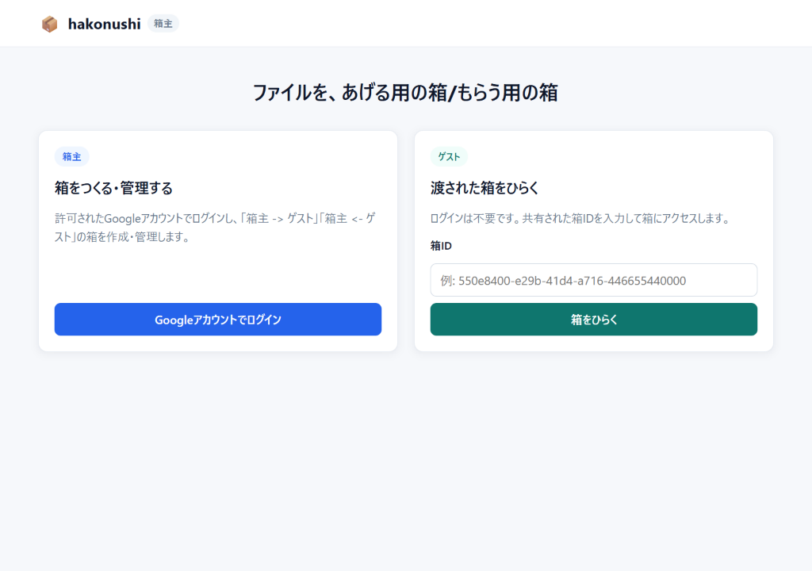
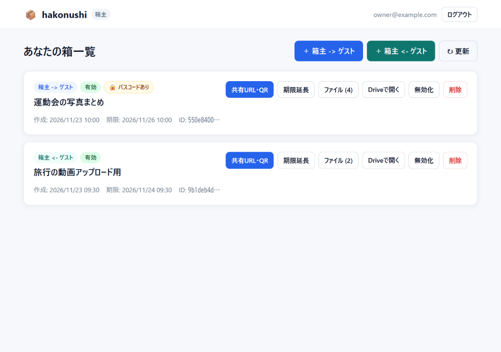
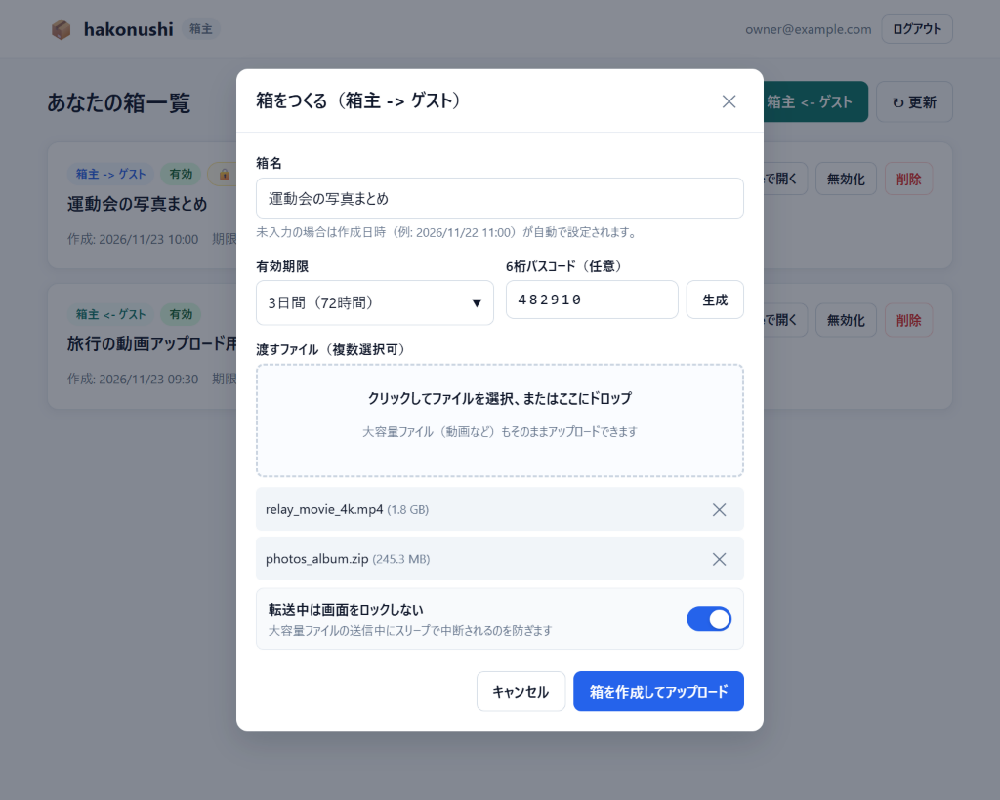
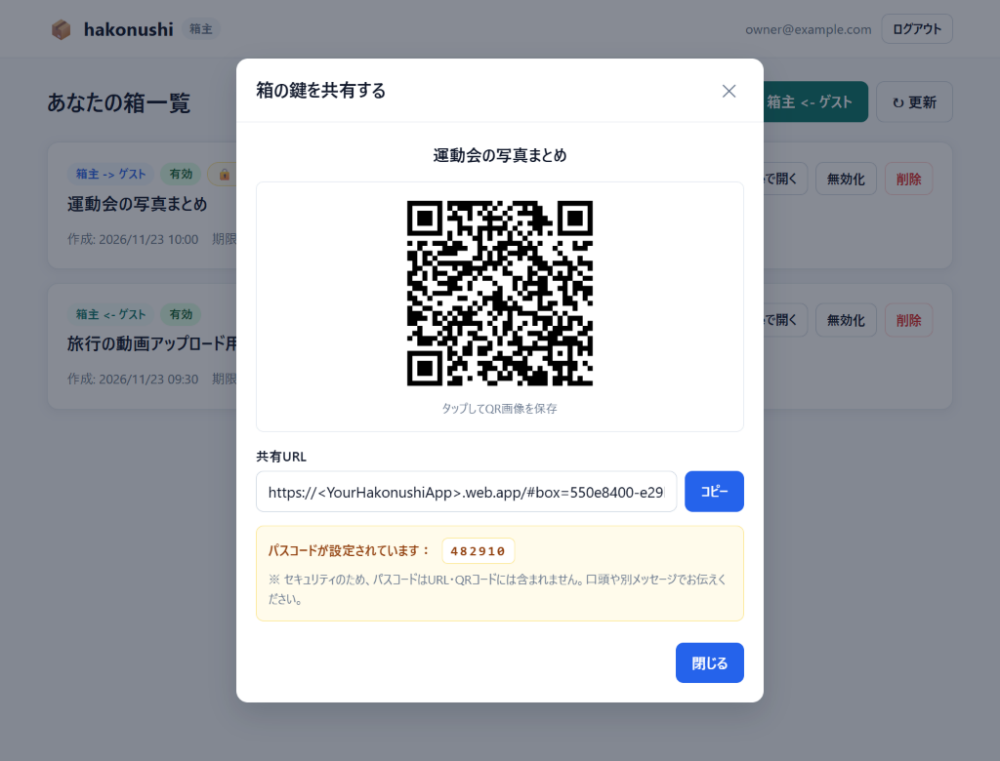
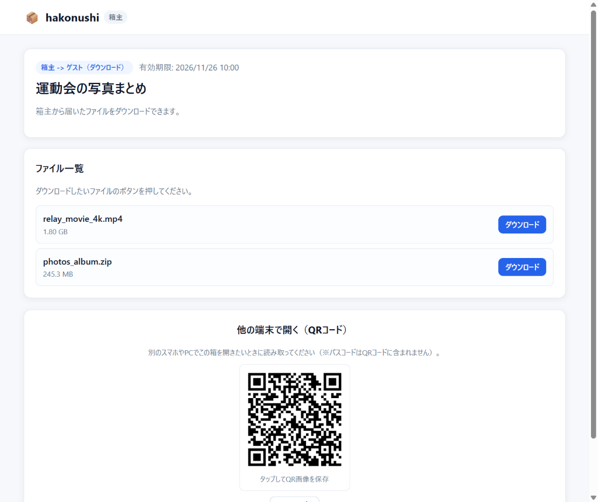
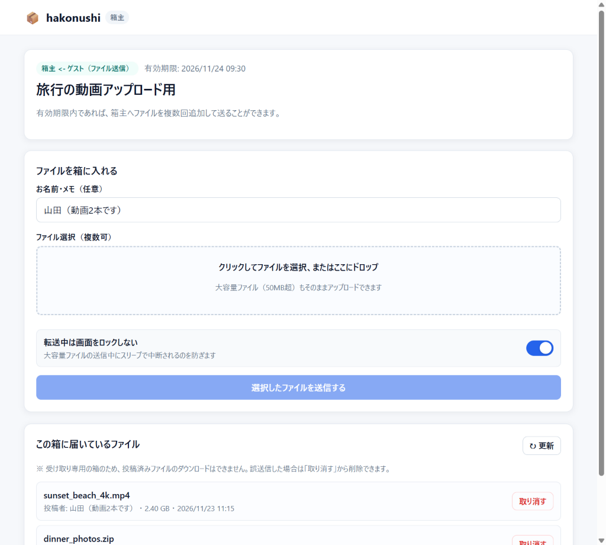

# hakonushi（箱主）

**相手にログインさせずに、自分の Google Drive を使って大容量ファイルを「あげる・もらう」できる、セルフホスト型の軽量ファイル受け渡しアプリです。**

> 開発の背景や詳しい紹介記事（note）：
> [【箱主】～hakonushi～ 相手のログインは不要。 データを送ってもらう／送ってあげる なアプリを作りました｜jun8k2003](https://note.com/jun8k2003/n/n39ef4d2ba3fb)

---

## どのようなアプリか

**hakonushi（箱主）** は、ファイル本体を直接共有するのではなく **「入れ物（箱）」** を一時的につくって URL や QR コードで鍵を渡す、個人・家族向けのファイル送受信中継アプリです。

* **箱主（あなた・家族）**: Google アカウントでログインし、**「箱主 -> ゲスト（ファイルをあげる箱）」** または **「箱主 <- ゲスト（ファイルをもらう箱）」** を作成・管理します。
* **ゲスト（相手）**: **ログイン不要**。渡された URL または QR コード（＋任意の6桁パスコード）だけで、ファイルをダウンロードしたり、自分のスマホ・PC から動画や写真を箱へ入れたりできます。

---

## 解決する課題

### 1. 相手にログインやアカウント登録をさせたくない
Google Drive の標準機能で「相手からファイルをもらう」には、相手にも Google ログインや編集権限の付与が必要になり、IT に不慣れな家族や取引先にはハードルが高くなります。
**hakonushi** なら、ゲストはブラウザで共有 URL を開くだけで **ログイン不要** で受け取り・送信の両方が完結します。

### 2. 有料サービスや広告付き転送サイトを使わずに大容量を送受信したい
外部の無料ファイル転送サービスは、広告が多い・容量制限が厳しい・見知らぬ第三者サーバーにプライベートな写真や動画を預ける不安がある、といった課題があります。
**hakonushi** は **あなた自身の Google Drive をそのままストレージとして利用** するため、追加の月額課金や広告なしで、契約中の Google Drive 容量（無料 15 GB〜Google One 数 TB）を活かして **1ファイル最大 15 GB クラスの撮影動画** まで安全に受け渡しできます。

---

## 運用の流れ（スクリーンショットで見る使い方）

※ 以下のスクリーンショットはすべてダミーデータによる動作イメージです。

### Step 1. アプリを開く（箱主 / ゲスト選択）
トップ画面から、箱をつくる **箱主** は Google ログイン、渡された箱を開く **ゲスト** は箱 ID 入力（または共有 URL に直接アクセス）で進みます。



### Step 2. 箱主ダッシュボードで箱を管理する
ログインすると自分の箱一覧が表示されます。「**＋ 箱主 -> ゲスト**」「**＋ 箱主 <- ゲスト**」から新しい箱を作成でき、作成済みの箱に対して **共有URL・QRの再表示**、**期限延長 / 再開**、**ファイル確認・個別ダウンロード**、**無効化**、**削除** をワンクリックで操作できます。



### Step 3. ファイルをあげる箱をつくる（箱主 -> ゲスト）
箱名（未入力時は作成日時を自動設定）、有効期限（**30分〜30日**）、任意の **6桁パスコード** を指定し、渡したいファイルをドラッグ＆ドロップで選択します。
送信中は **16 MB ずつのチャンク分割アップロード**（自動リトライ対応）と、スマホのスリープ中断を防ぐ **「転送中は画面をロックしない」スイッチ** で大容量動画も安定して送れます。



### Step 4. 共有URL・QRコードで「鍵」をゲストに渡す
箱の作成が終わると、フラグメント形式の共有 URL（`#box=<GUID>`）と、ブラウザ内でローカル生成された **QR コード** が表示されます。
* **QR コードをタップ／クリックすると PNG 画像としてそのまま保存**でき、LINE やメールに貼って簡単に共有できます。
* セキュリティのため、6桁パスコードは URL・QR コードには含まれません（口頭や別メッセージで伝える運用です）。



### Step 5. ゲストがファイルを受け取る（ログイン不要）
ゲストが共有 URL を開くと、**Google ログインなし** でファイル一覧が表示され、ボタン1つでダウンロードできます（スマホでも MP4 動画が Google ドライブアプリに横取りされず直接保存されます）。
画面下部には **「他の端末で開く（QRコード）」** も表示されるため、「PC で受け取ったリンクをスマホに転送して保存する」といった使い方もスムーズです。



### Step 6. ゲストからファイルをもらう（箱主 <- ゲスト・ログイン不要）
「箱主 <- ゲスト」の空箱を共有すれば、ゲストは **ログイン不要** で動画や写真（1ファイル最大 **15 GB** / 1箱最大 **1,000 件** / 合計 **50 GB**）を何度でも追加送信できます。
* ゲスト側の一覧は **確認と誤送信の「取り消す」のみ可能** で、他のファイルを含めダウンロードは一切できない設計です。
* 箱主はダッシュボードから非公開のまま安全にダウンロードできます。



### Step 7. 期限切れ後の運用（延長・再開・削除）
* **期限切れ・無効化**: 1時間おきの自動クリーンアップで `EXPIRED` になり一時公開権限を即時解除します。ファイル自体は残るため、取り損ねた相手がいれば **「再開・延長」** から同じ URL・QR のまま再共有できます。
* **箱の削除**: 受け渡しが終わって不要になったら、念押し確認モーダルから **「削除」** を実行して管理一覧から消し、Drive のゴミ箱へ移動します。

---

## 主な特徴

* **2種類の箱と明確な権限分離**:
  * **箱主 -> ゲスト (`SEND`)**: 複数ファイルを箱に入れて共有（有効期限 30分〜30日）。期限切れ・無効化時は公開権限のみ即時解除し、必要なら同じ URL のまま **期限延長・再開** が可能。
  * **箱主 <- ゲスト (`RECEIVE`)**: 空の箱を共有して相手から動画や写真を回収。ゲストからは投稿・誤送信の取消のみ可能（**ダウンロード不可**）。
* **15 GB クラスの大容量動画＆最大 1,000 件対応**:
  * Google Drive API v3 の Resumable Upload を使い、ブラウザから Google Drive へ **16 MB ずつのチャンク分割で直接 `PUT`**（GAS の 50 MB 制限を回避・最大5回の自動リトライ＆途中再開対応）。
  * 送信中のスリープ中断を防ぐ **「転送中は画面をロックしない」トグル**（Screen Wake Lock API）を搭載。
* **セキュリティ・プライバシー設計**:
  * 共有 URL はフラグメント形式（`https://<your-domain>/#box=<GUID>`）＋ `Referrer-Policy: no-referrer` で、アクセスログや遷移先への箱 ID 漏洩を防止。
  * QR コードは外部 API を使わずブラウザ内でローカル生成（タップで PNG 保存可、パスコードは含めません）。
  * パスコードは `box_id` ソルト＋自動生成ペッパー付き HMAC-SHA256 で保護し、ロック内直列化・5回連続失敗で自動ロック。
  * 外部 CDN 依存ゼロ（Firebase SDK・QR 生成ライブラリをローカル同梱）＋ 厳格な CSP / `X-Frame-Options: DENY`。
* **ゼロ設定のフォルダ自動整理**:
  * スプレッドシートの親フォルダを相対解決で自動検出し、`{owner_email}/{box_id}/` 配下に自動整理します。

---

## 使用サービス（すべて無料枠で稼働可能）

| サービス | 役割 |
| :--- | :--- |
| **Google Drive** | アップロードされたファイルの保存先（ご自身の Google アカウント容量を利用） |
| **Google Sheets** | 箱（`boxes`）およびファイル（`files`）の管理データベース |
| **Google Apps Script (GAS)** | コンテナバインド型バックエンド API（`doPost`）および定期クリーンアップトリガー |
| **Firebase Hosting** | 静的フロントエンド（HTML / CSS / JS）の配信（Spark 無料プラン） |
| **Firebase Authentication** | 箱主用の Google ログイン認証（未確認アプリ警告なし） |

---

## 技術スタック

* **フロントエンド**: 静的 HTML / CSS / Vanilla JavaScript（ビルドツール・`npm` 依存なし）
  * 通信: `fetch`（CORS プリフライト回避のため `Content-Type: text/plain`）、`XMLHttpRequest`（16 MB チャンク分割直接 `PUT`＋リアルタイム進捗バー）
  * UI / UX: Screen Wake Lock API（転送中の画面ロック防止）、`qrcode-generator`（ローカル SVG/PNG QR コード生成）
  * 同梱ライブラリ: Firebase JS SDK v10（compat）、`qrcode-generator` v1.4.4
* **バックエンド**: Google Apps Script（V8 ランタイム）
  * ストレージ API: Google Drive API v3（Resumable Upload / `Drive.Permissions`）＋ `DriveApp`
  * 認証検証: Firebase Identity Toolkit REST API（`accounts:lookup`）＋ 許可メールアドレスリスト照合
  * 排他制御・暗号化: `LockService.getScriptLock()`、`Utilities.computeHmacSha256Signature()`

---

## 設計ガイド・通信アーキテクチャ解説

アプリの仕組みや画面遷移・通信フローを視覚的に確認できるインタラクティブな HTML ガイドを `docs/` 配下に同梱しています。

* **設計ガイド・画面モック**: [docs/index.html](./docs/index.html)（GitHub Pages: https://jun8k2003.github.io/hakonushi-pub/ ）
* **通信アーキテクチャ & 運用フロー解説**: [docs/architecture.html](./docs/architecture.html)（GitHub Pages: https://jun8k2003.github.io/hakonushi-pub/architecture.html ）

---

## ディレクトリ構成

```text
hakonushi-pub/
├── gas/                       # コンテナバインド GAS バックエンド
│   ├── Config.gs              # 設定読み込み・フォルダ相対解決・openById 透過取得
│   ├── Database.gs            # setupDatabase()・LockService 排他制御・CRUD
│   ├── Auth.gs                # Firebase ID トークン検証・HMAC-SHA256
│   ├── DriveHelper.gs         # Resumable Upload・権限管理・ゴミ箱移動
│   ├── OwnerApi.gs            # 箱主向け API ハンドラ
│   ├── GuestApi.gs            # ゲスト向け API ハンドラ
│   ├── Main.gs                # doPost ルーター
│   ├── Trigger.gs             # 期限切れ箱・一時共有の自動クリーンアップ
│   ├── appsscript.json        # GAS マニフェスト（Drive API v3 有効化）
│   └── .clasp.json.example
├── public/                    # Firebase Hosting 静的フロントエンド
│   ├── index.html
│   ├── styles.css
│   ├── config.example.js      # 設定テンプレート（config.js は .gitignore 対象）
│   └── js/
│       ├── api.js             # GAS 通信・チャンク分割 PUT・Wake Lock・QR 生成
│       ├── auth.js            # Firebase Auth Google ログイン
│       ├── owner.js           # 箱主画面（作成・延長・共有・削除）
│       ├── guest.js           # ゲスト画面（DL・QR・アップロード・取消）
│       ├── router.js          # #box=<GUID> ハッシュルーター
│       └── vendor/            # ローカル同梱ライブラリ（外部 CDN 依存ゼロ）
├── docs/
│   ├── index.html             # インタラクティブ設計ガイド・モック
│   ├── architecture.html      # 通信アーキテクチャ & 運用フロー解説
│   └── images/                # README 用スクリーンショット（6枚）
├── scripts/
│   └── copy_gas.ps1           # GAS 全ファイル結合・コピー用スクリプト
├── copy_gas_to_clipboard.bat  # Windows 用 1 クリック GAS コピーバッチ
├── firebase.json              # Hosting 設定・セキュリティヘッダ（CSP 等）
├── .firebaserc.example
├── SPEC.md                    # アプリケーション仕様書
├── BUILD_PLAN.md              # 構築計画書
├── SETUP_GUIDE.md             # 導入・配置作業手順書
└── PROGRESS.md                # 開発進捗記録
```

---

## 導入手順

詳しいセットアップ方法は [SETUP_GUIDE.md](./SETUP_GUIDE.md) を参照してください。

---

## ライセンス

本プロジェクトは [LICENSE](./LICENSE)（MIT License）のもとで公開されています。

### サードパーティライセンス

`public/js/vendor/` 配下に同梱しているライブラリは以下のライセンスに従います。

* **Firebase JS SDK** (`firebase-app-compat.js`, `firebase-auth-compat.js` v10.14.1) — Apache License 2.0 (Copyright Google LLC)
* **qrcode-generator** (`qrcode.min.js` v1.4.4) — MIT License (Copyright Kazuhiko Arase)
